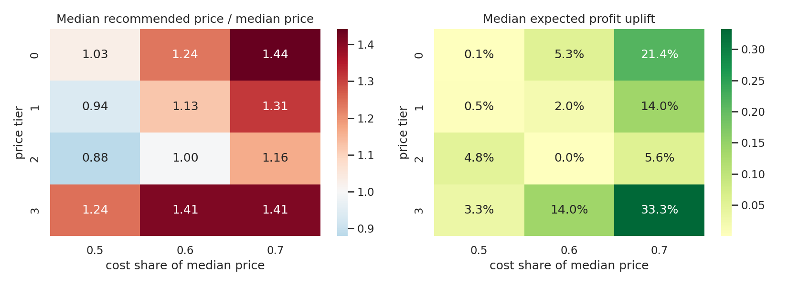
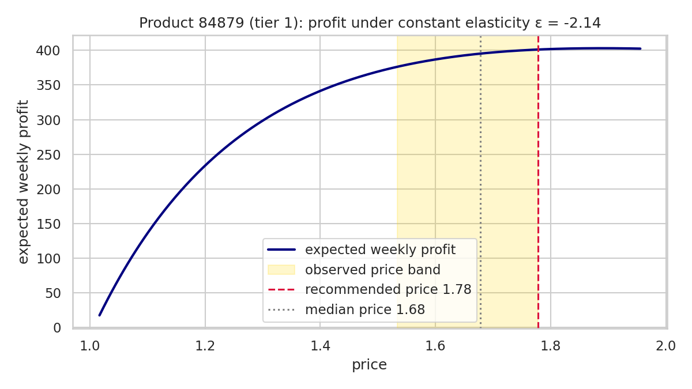
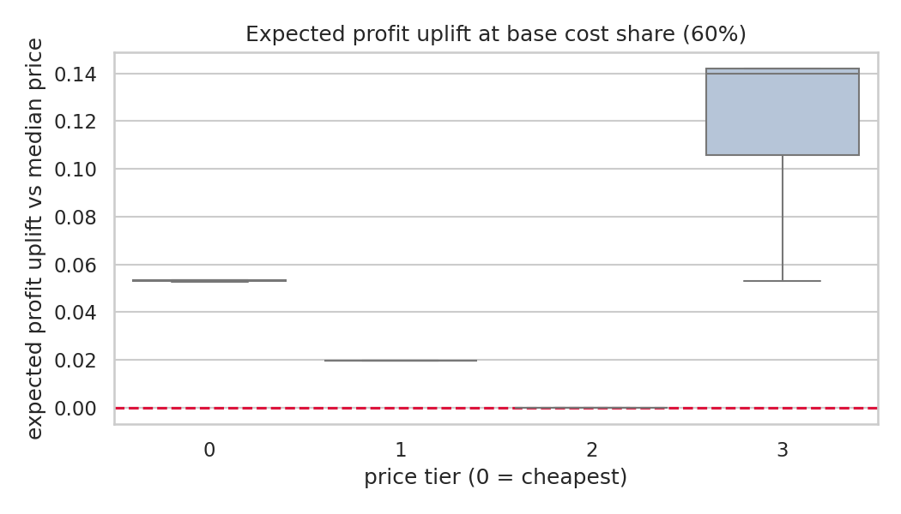

# Dynamic Pricing: Optimal Price Under Constant Elasticity

**Question.** Given a price elasticity per product tier, what weekly price maximises expected profit, and how sensitive is that answer to the assumptions?

This is the second project in the dynamic pricing portfolio. It takes the elasticities from [dynamic-pricing-elasticity](https://github.com/Patotricks15/dynamic-pricing-elasticity) (`v0.1.0`, tier ε between −1.67 and −2.51) and turns them into price recommendations.

## Method

With demand `q = q0 (p/p0)^ε` and `ε < −1`, expected profit `(p − c)·q` is maximised at

`p* = ε / (1 + ε) · c`

- `p0` and `q0` are each product's median weekly price and quantity.
- The result is clipped to the product's observed weekly price band (5th to 95th percentile), so no price is extrapolated beyond the data. Clipped prices are flagged.
- If `ε ≥ −1`, there is no interior optimum. The upper band edge is returned and flagged.

## Key assumption: unit cost

The data has no cost column. Unit cost is set to **60% of the median price** (a 40% gross margin). The notebook runs 50% and 70% as well. This assumption dominates the result. The elasticity confidence intervals move the median recommended price by only about ±3%.

## Results

| Tier (price quartile) | ε | Median price / median price (60% cost) | Clipped | Median profit uplift (60% cost) |
|---|---|---|---|---|
| 0 (cheapest) | −1.94 | 1.24× | 28% | 5.3% |
| 1 | −2.14 | 1.13× | 14% | 2.0% |
| 2 (most elastic) | −2.51 | 1.00× | 10% | 0.0% |
| 3 (dearest) | −1.67 | 1.41× | 58% | 14.0% |

1,639 products, about 410 per tier.

- At 60% cost, the recommendations are small moves. Tier 2 should stay at its median price. Tier 3 has the largest increase, but 58% of its products are clipped to the band top, so those recommendations are extrapolations.
- The recommended multiple rises with cost share in every tier. At 50% cost it is 0.88× to 1.24×, and at 70% it is 1.16× to 1.44×.
- The median uplift is very sensitive to cost. At 70% cost it reaches 21% in tier 0 and 33% in tier 3.







## Limitation

These are **recommendations under an associative elasticity, not causal price effects.** The elasticity from DP01 is not identified from observational data: prices and demand move together for reasons such as promotions and seasonality. The notebook treats the output as a sensitivity map for a pricing decision. It should not be deployed without a randomised price test. The data also carries an unconfirmed "other" license and a declared origin of a UK online gift retailer (see [data/README.md](data/README.md)).

## Reproduce

```bash
python -m venv .venv && . .venv/bin/activate
pip install -e ".[dev]"        # also installs dp-elasticity from its v0.1.0 tag
export KAGGLE_API_TOKEN=...    # never commit the token
bash scripts/download_data.sh
jupytext --to ipynb notebooks/optimal_price.py
jupyter nbconvert --to notebook --execute --inplace notebooks/optimal_price.ipynb
pytest
```

## Layout

```
src/dp_pricing/optimal.py   optimal_price, expected_profit, product_bands, recommend
tests/test_optimal.py       closed form, band clipping, inelastic case, profit maximum
notebooks/optimal_price.py  analysis (jupytext percent format); optimal_price.ipynb is executed
reports/figures/            charts used above
data/README.md              provenance and cost assumption
```
